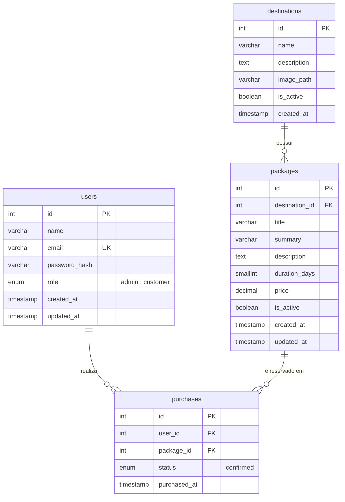

# Destyn Trips — README do Projeto Integrador

Agência digital de viagens — catálogo de roteiros, autenticação, reservas e área administrativa.

**Stack:** PHP puro · MySQL · Tailwind CSS (CDN) · Lucide · XAMPP / Docker · GitHub  
**Domínio de marca:** [destyntrips.com.br](https://destyntrips.com.br)

| | |
| --- | --- |
| Setup Windows (faculdade) | [`.agents/SETUP_WINDOWS_XAMPP.md`](.agents/SETUP_WINDOWS_XAMPP.md) |
| PRD / TechSpec / Tasks | [`.agents/`](.agents/) |
| Backup do banco | [`database/backups/projeto_integrador_backup.sql`](database/backups/projeto_integrador_backup.sql) |

---

## Sobre o projeto

A **Destyn Trips** é a aplicação do Projeto Integrador: um site acadêmico em que visitantes exploram destinos, clientes se cadastram e reservam pacotes, e administradores gerenciam catálogo, clientes e reservas.

Não há gateway de pagamento real. O checkout valida campos de cartão apenas por **formato e tamanho** e registra a reserva com status `confirmed`.

### Funcionalidades

- Landing page com destinos em destaque, serviços, depoimentos e galeria
- Catálogo de roteiros e página de detalhes dia a dia (`roteiro.php`)
- Cadastro / login com sessão PHP e senhas em `password_hash`
- Área do cliente com histórico de reservas
- Compra com formulário de cartão (validação local) e CSRF
- Admin: dashboard, CRUD de pacotes, clientes e reservas (paginação 10/página)
- i18n: português (`pt_BR`), inglês e espanhol
- Identidade visual Destyn Trips (laranja `#faa935`)

### Requisitos da disciplina atendidos

1. Login com autenticação via banco  
2. Área administrativa protegida  
3. Entidades relacionadas (`users`, `destinations`, `packages`, `purchases`)  
4. CRUD completo de pacotes  
5. Front-end, back-end e banco integrados  
6. Interface navegável com identidade própria  

---

## Stack

| Camada | Tecnologia |
| --- | --- |
| Linguagem | PHP 8+ (páginas server-rendered) |
| Banco | MySQL (`utf8mb4`) |
| UI | HTML + Tailwind CDN + CSS próprio |
| Ícones | Lucide (CDN) |
| Segurança | Sessão, CSRF, `password_hash`, escape `e()` |
| Ambiente | XAMPP (faculdade) ou Docker (dev) |

---

## Modelo de dados

Quatro tabelas com chaves estrangeiras restritivas e desativação lógica (`is_active`) em destinos e pacotes.



**Schema SQL:** [`database/database.sql`](database/database.sql)

---

## Arquitetura (visão rápida)

```text
Navegador
  → frontend/pages/*.php  (+ components/)
  → backend/controllers
  → backend/services
  → backend/models (PDO)
  → MySQL
```

Bootstrap único: `backend/bootstrap.php` (sessão, i18n, PDO, services).

---

## Estrutura do repositório

```text
├── .agents/                 # PRD, techspec, tasks, guia Windows/XAMPP
├── backend/
│   ├── bootstrap.php
│   ├── config/              # database.example.php → database.php (local)
│   ├── controllers/
│   ├── data/                # catálogo de destinos (textos)
│   ├── helpers/
│   ├── i18n/
│   ├── models/
│   └── services/
├── database/
│   ├── database.sql         # só estrutura
│   ├── backups/             # dump completo (estrutura + dados demo)
│   └── seeds/seed.php
├── docs/                    # setup, arquitetura, identidade
├── frontend/
│   ├── index.php
│   ├── components/
│   ├── pages/               # públicas, client/, admin/
│   ├── css/ · js/ · assets/
├── tests/
├── docker-compose.yml
└── index.php                # redireciona para frontend/
```

---

## Setup rápido (Windows + XAMPP)

Passo a passo completo: **[`.agents/SETUP_WINDOWS_XAMPP.md`](.agents/SETUP_WINDOWS_XAMPP.md)**.

1. Inicie **Apache** e **MySQL** no XAMPP.  
2. Coloque o projeto em `C:\xampp\htdocs\projeto-integrador-php\`.  
3. Copie `backend/config/database.example.php` → `backend/config/database.php`.  
4. No phpMyAdmin (`http://localhost/phpmyadmin`), **importe**:

```text
database/backups/projeto_integrador_backup.sql
```

5. Abra:

```text
http://localhost/projeto-integrador-php/
```

### Alternativa (schema + seed)

1. Importe `database/database.sql`  
2. Execute `database/seeds/seed.php` com `SEED_ADMIN_PASSWORD` e `SEED_CUSTOMER_PASSWORD` (ver guia)

### Docker (opcional)

```bash
docker compose up -d --build
# app: http://localhost:3080  ·  MySQL: localhost:3307
```

---

## Contas de demonstração

Após importar o backup (ou rodar o seed com as senhas do guia):

| Papel | E-mail | Senha |
| --- | --- | --- |
| Admin | `thiago.barbosa@destyntrips.com` | `SenhaAdminDemo1` |
| Admin | `arthur.inacio@destyntrips.com` | `SenhaAdminDemo1` |
| Admin | `pedro.gomes@destyntrips.com` | `SenhaAdminDemo1` |
| Cliente | `marina.costa@destyntrips.com` | `SenhaClienteDemo1` |

Há outros 19 clientes seed com a mesma senha de cliente.

---

## Rotas principais

| Área | URL |
| --- | --- |
| Home | `/frontend/index.php` |
| Sobre | `/frontend/pages/about.php` |
| Roteiros | `/frontend/pages/tours.php` |
| Detalhe (catálogo) | `/frontend/pages/roteiro.php?destino=dubai` |
| Login / Cadastro | `/frontend/pages/login.php` · `register.php` |
| Cliente | `/frontend/pages/client/dashboard.php` |
| Compra | `/frontend/pages/client/purchase.php` |
| Admin | `/frontend/pages/admin/index.php` |
| CRUD pacotes | `/frontend/pages/admin/packages.php` |
| Clientes / Reservas | `/frontend/pages/admin/users.php` · `reservations.php` |

---

## Testes

```bash
php tests/unit/run.php
php tests/integration/run.php   # requer MySQL + database.php
```

Checklist E2E: [`tests/e2e/CHECKLIST.md`](tests/e2e/CHECKLIST.md)

---

## Documentação

| Documento | Conteúdo |
| --- | --- |
| [`.agents/prd.md`](.agents/prd.md) | Requisitos do produto |
| [`.agents/techspec.md`](.agents/techspec.md) | Especificação técnica |
| [`.agents/tasks.md`](.agents/tasks.md) | Tarefas de implementação |
| [`.agents/SETUP_WINDOWS_XAMPP.md`](.agents/SETUP_WINDOWS_XAMPP.md) | Abrir no XAMPP + importar backup |
| [`docs/SETUP_XAMPP.md`](docs/SETUP_XAMPP.md) | Resumo de setup |
| [`docs/ARQUITETURA.md`](docs/ARQUITETURA.md) | Arquitetura |
| [`docs/IDENTIDADE_VISUAL.md`](docs/IDENTIDADE_VISUAL.md) | Marca e tokens |
| [`docs/GIT_WORKFLOW.md`](docs/GIT_WORKFLOW.md) | Fluxo Git/GitHub |

---

## Equipe

Projeto Integrador — TSI / Senac  
Organização no GitHub: [`tsi-group-senac`](https://github.com/tsi-group-senac) · repositório [`projeto-integrador-php`](https://github.com/tsi-group-senac/projeto-integrador-php)

Admins seed (grupo): Thiago Barbosa, Arthur Inacio, Pedro Gomes.

---

## Materiais da disciplina

- [Aula 01 — Definição do Projeto](https://docs.google.com/presentation/d/1aHc31MrEDHxEBw8pOtDuAwAxgzIZJi4l/edit?usp=sharing&ouid=112595941029232116373&rtpof=true&sd=true)
- [Aula 02 — Git e GitHub](https://docs.google.com/presentation/d/1ooSOhHy7P4sLNeCdVd0QGIS4AEnzlNMK/edit?usp=sharing&ouid=112595941029232116373&rtpof=true&sd=true)
- [Notion da disciplina](https://deluxe-blue-bc1.notion.site/Projeto-Integrador-II-Aplica-o-Web-Din-mica-305dfca74d8d80ee9cf3dbbb08257c7c?source=copy_link)

---

## Licença / uso acadêmico

Material desenvolvido para fins acadêmicos do Projeto Integrador. Não realiza cobranças, reservas ou emissões reais de viagem.
